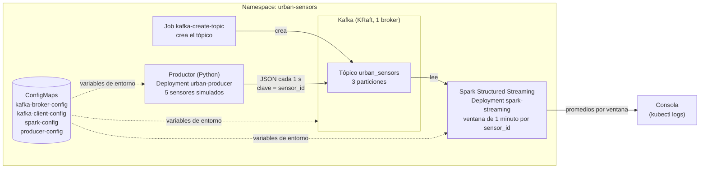

# Plataforma de Muestreo Urbano en Tiempo Real

Arquitectura de ingeniería de datos distribuida sobre **Kubernetes**: sensores urbanos simulados envían lecturas a **Apache Kafka** y **Apache Spark Structured Streaming** las procesa en tiempo real, calculando por ventanas de 1 minuto el promedio de temperatura y de calidad del aire de cada sensor.

## Arquitectura



### Formato de las lecturas (JSON)

```json
{
  "sensor_id": "sensor-003",
  "temperature": 21.37,
  "humidity": 58.2,
  "air_quality_index": 74,
  "timestamp": "2026-10-24T14:35:00+00:00"
}
```

El productor usa `sensor_id` como clave del mensaje: todas las lecturas de un sensor van a la misma partición y conservan su orden.

## Estructura del repositorio

```
.
├── k8s/                          # Manifiestos de Kubernetes
│   ├── 00-namespace.yaml         # Namespace urban-sensors
│   ├── 01-configmaps.yaml        # ConfigMaps de Kafka, Spark y productor
│   ├── 10-kafka.yaml             # Deployment + Service de Kafka (KRaft)
│   ├── 11-kafka-topic-job.yaml   # Job que crea el tópico con 3 particiones
│   ├── 20-producer.yaml          # Deployment del productor
│   └── 30-spark-streaming.yaml   # Deployment del job de Spark
├── apps/
│   ├── producer/                 # producer.py + requirements.txt
│   └── spark/                    # streaming_job.py
├── scripts/
│   ├── deploy.sh                 # Despliega todo (equivale a los kubectl del README)
│   └── destroy.sh                # Borra el namespace
└── docs/img/                     # Capturas de evidencia
```

## ConfigMaps (variables de entorno)

Ninguna configuración está escrita en el código: se inyecta por variables de entorno desde ConfigMaps (`k8s/01-configmaps.yaml`). El código del productor y del job de Spark también se entrega como ConfigMaps (`producer-code` y `spark-job-code`), por lo que no hace falta construir imágenes de Docker.

| ConfigMap | Usado por | Variables principales |
|---|---|---|
| `kafka-broker-config` | Broker de Kafka | `KAFKA_NODE_ID`, `KAFKA_LISTENERS`, `KAFKA_ADVERTISED_LISTENERS`, `KAFKA_AUTO_CREATE_TOPICS_ENABLE`... |
| `kafka-client-config` | Productor, Spark y Job del tópico | `KAFKA_BOOTSTRAP_SERVERS`, `KAFKA_TOPIC`, `KAFKA_TOPIC_PARTITIONS` |
| `spark-config` | Job de Spark | `SPARK_WINDOW_DURATION`, `SPARK_WATERMARK_DELAY`, `SPARK_TRIGGER_INTERVAL`, `SPARK_STARTING_OFFSETS`... |
| `producer-config` | Productor | `PRODUCER_NUM_SENSORS`, `PRODUCER_INTERVAL_SECONDS` |

No hay credenciales en el repositorio: Kafka funciona sin autenticación dentro del cluster (`PLAINTEXT`). Si se agregaran usuarios o contraseñas, tendrían que ir en un `Secret`.

## Requisitos

- Docker
- `kubectl`
- Un cluster local de Kubernetes: **minikube** (se usa en esta guía) o kind
- Conexión a internet en el cluster (para bajar imágenes, la librería del productor y el conector de Kafka para Spark)

Instalación en Fedora/Nobara:

```bash
sudo dnf install -y kubernetes-client          # kubectl
curl -LO https://storage.googleapis.com/minikube/releases/latest/minikube-linux-amd64
sudo install minikube-linux-amd64 /usr/local/bin/minikube
```

## Cómo desplegarlo

### 1. Crear el cluster local

```bash
# Equipo con 8 GB de RAM o más:
minikube start --driver=docker --cpus=4 --memory=6144

# Equipo con 4 GB de RAM (ver la sección "Equipos con poca memoria"):
minikube start --driver=docker --cpus=2 --memory=2200mb

kubectl get nodes
```

El nodo tiene que figurar como `Ready`. Spark y Kafka necesitan memoria: los manifiestos ya vienen ajustados a un uso bajo (Kafka con unos 400 MB de heap y Spark con 512 MB), pero con menos de unos 2 GB en el cluster los pods pueden quedar en `Pending` o reiniciarse.

### 2. Desplegar los servicios

Con un solo comando:

```bash
./scripts/deploy.sh
```

O paso a paso (es lo mismo que hace el script):

```bash
# Namespace y configuración
kubectl apply -f k8s/00-namespace.yaml
kubectl apply -f k8s/01-configmaps.yaml

# Código de la aplicación, como ConfigMaps
kubectl create configmap producer-code  -n urban-sensors --from-file=apps/producer/ --dry-run=client -o yaml | kubectl apply -f -
kubectl create configmap spark-job-code -n urban-sensors --from-file=apps/spark/    --dry-run=client -o yaml | kubectl apply -f -

# Kafka y tópico
kubectl apply -f k8s/10-kafka.yaml
kubectl rollout status deployment/kafka -n urban-sensors
kubectl apply -f k8s/11-kafka-topic-job.yaml
kubectl wait --for=condition=complete job/kafka-create-topic -n urban-sensors --timeout=300s

# Productor y Spark
kubectl apply -f k8s/20-producer.yaml
kubectl apply -f k8s/30-spark-streaming.yaml
```

### 3. Comprobar que todo corre

```bash
kubectl get pods -n urban-sensors
```

Tienen que quedar `Running` el broker, el productor y Spark, y `Completed` el Job del tópico. El pod de Spark tarda uno o dos minutos la primera vez porque descarga el conector de Kafka.

## Evidencias de funcionamiento

Los comandos para comprobar el flujo completo son estos. Las capturas o logs obtenidos van en `docs/img/` o pegados debajo de cada comando.

**1. El tópico tiene 3 particiones**

```bash
kubectl logs job/kafka-create-topic -n urban-sensors
```

Tiene que mostrar `PartitionCount: 3` y las particiones 0, 1 y 2.

```
Topic: urban_sensors    TopicId: DyvGyNcMR4ur9QTNOy8XrQ PartitionCount: 3       ReplicationFactor: 1    Configs: 
        Topic: urban_sensors    Partition: 0    Leader: 1       Replicas: 1     Isr: 1  Elr:    LastKnownElr: 
        Topic: urban_sensors    Partition: 1    Leader: 1       Replicas: 1     Isr: 1  Elr:    LastKnownElr: 
        Topic: urban_sensors    Partition: 2    Leader: 1       Replicas: 1     Isr: 1  Elr:    LastKnownElr: 
```

**2. El productor está enviando lecturas**

```bash
kubectl logs deploy/urban-producer -n urban-sensors --tail=15
```

```
[ENVIADO] partición=1 offset=3956 {"sensor_id": "sensor-002", "temperature": 20.6, "humidity": 50.42, "air_quality_index": 40, "timestamp": "2026-10-24T19:54:41+00:00"}
[ENVIADO] partición=1 offset=3957 {"sensor_id": "sensor-002", "temperature": 22.02, "humidity": 52.45, "air_quality_index": 31, "timestamp": "2026-10-24T19:54:42+00:00"}
[ENVIADO] partición=0 offset=2539 {"sensor_id": "sensor-001", "temperature": 22.45, "humidity": 72.09, "air_quality_index": 90, "timestamp": "2026-10-24T19:54:43+00:00"}
[ENVIADO] partición=1 offset=3958 {"sensor_id": "sensor-002", "temperature": 22.33, "humidity": 48.91, "air_quality_index": 30, "timestamp": "2026-10-24T19:54:44+00:00"}
[ENVIADO] partición=0 offset=2540 {"sensor_id": "sensor-003", "temperature": 12.47, "humidity": 51.74, "air_quality_index": 37, "timestamp": "2026-10-24T19:54:45+00:00"}
[ENVIADO] partición=1 offset=3959 {"sensor_id": "sensor-005", "temperature": 25.25, "humidity": 62.51, "air_quality_index": 79, "timestamp": "2026-10-24T19:54:46+00:00"}
[ENVIADO] partición=1 offset=3960 {"sensor_id": "sensor-005", "temperature": 27.15, "humidity": 61.17, "air_quality_index": 78, "timestamp": "2026-10-24T19:54:47+00:00"}
[ENVIADO] partición=0 offset=2541 {"sensor_id": "sensor-001", "temperature": 23.05, "humidity": 69.44, "air_quality_index": 84, "timestamp": "2026-10-24T19:54:48+00:00"}
[ENVIADO] partición=1 offset=3961 {"sensor_id": "sensor-004", "temperature": 23.98, "humidity": 56.11, "air_quality_index": 35, "timestamp": "2026-10-24T19:54:49+00:00"}
[ENVIADO] partición=1 offset=3962 {"sensor_id": "sensor-005", "temperature": 26.5, "humidity": 63.36, "air_quality_index": 92, "timestamp": "2026-10-24T19:54:50+00:00"}
[ENVIADO] partición=0 offset=2542 {"sensor_id": "sensor-001", "temperature": 20.69, "humidity": 67.26, "air_quality_index": 80, "timestamp": "2026-10-24T19:54:51+00:00"}
[ENVIADO] partición=1 offset=3963 {"sensor_id": "sensor-004", "temperature": 29.99, "humidity": 62.61, "air_quality_index": 29, "timestamp": "2026-10-24T19:54:52+00:00"}
[ENVIADO] partición=0 offset=2543 {"sensor_id": "sensor-003", "temperature": 13.12, "humidity": 39.53, "air_quality_index": 20, "timestamp": "2026-10-24T19:54:53+00:00"}
[ENVIADO] partición=1 offset=3964 {"sensor_id": "sensor-004", "temperature": 26.13, "humidity": 72.54, "air_quality_index": 48, "timestamp": "2026-10-24T19:54:54+00:00"}
[ENVIADO] partición=0 offset=2544 {"sensor_id": "sensor-001", "temperature": 22.35, "humidity": 64.84, "air_quality_index": 97, "timestamp": "2026-10-24T19:54:55+00:00"}
```

**3. Spark está procesando esas lecturas** (promedios por ventana de 1 minuto y por `sensor_id`)

```bash
kubectl logs deploy/spark-streaming -n urban-sensors --tail=60
```

En los logs aparecen bloques `Batch: N` con una tabla de las columnas `window_start`, `window_end`, `sensor_id`, `avg_temperature`, `avg_air_quality_index` y `readings`.

```
Defaulted container "spark" out of: spark, wait-for-topic (init)
|2026-10-24 19:56:00|2026-10-24 19:57:00|sensor-001|21.37          |83.67                |3       |
|2026-10-24 19:56:00|2026-10-24 19:57:00|sensor-004|30.46          |38.5                 |2       |
|2026-10-24 19:56:00|2026-10-24 19:57:00|sensor-002|24.79          |53.0                 |3       |
+-------------------+-------------------+----------+---------------+---------------------+--------+

-------------------------------------------
Batch: 639
-------------------------------------------
+-------------------+-------------------+----------+---------------+---------------------+--------+
|window_start       |window_end         |sensor_id |avg_temperature|avg_air_quality_index|readings|
+-------------------+-------------------+----------+---------------+---------------------+--------+
|2026-10-24 19:56:00|2026-10-24 19:57:00|sensor-005|26.01          |96.0                 |5       |
|2026-10-24 19:56:00|2026-10-24 19:57:00|sensor-001|20.97          |82.4                 |5       |
|2026-10-24 19:56:00|2026-10-24 19:57:00|sensor-004|29.07          |39.0                 |3       |
|2026-10-24 19:56:00|2026-10-24 19:57:00|sensor-003|12.17          |27.5                 |2       |
|2026-10-24 19:56:00|2026-10-24 19:57:00|sensor-002|24.31          |48.6                 |5       |
+-------------------+-------------------+----------+---------------+---------------------+--------+

-------------------------------------------
Batch: 640
-------------------------------------------
+-------------------+-------------------+----------+---------------+---------------------+--------+
|window_start       |window_end         |sensor_id |avg_temperature|avg_air_quality_index|readings|
+-------------------+-------------------+----------+---------------+---------------------+--------+
|2026-10-24 19:56:00|2026-10-24 19:57:00|sensor-005|25.61          |94.25                |8       |
|2026-10-24 19:56:00|2026-10-24 19:57:00|sensor-001|20.63          |80.33                |6       |
|2026-10-24 19:56:00|2026-10-24 19:57:00|sensor-004|28.52          |41.75                |4       |
|2026-10-24 19:56:00|2026-10-24 19:57:00|sensor-003|12.47          |32.83                |6       |
|2026-10-24 19:56:00|2026-10-24 19:57:00|sensor-002|24.09          |44.5                 |6       |
+-------------------+-------------------+----------+---------------+---------------------+--------+

-------------------------------------------
Batch: 641
-------------------------------------------
+-------------------+-------------------+----------+---------------+---------------------+--------+
|window_start       |window_end         |sensor_id |avg_temperature|avg_air_quality_index|readings|
+-------------------+-------------------+----------+---------------+---------------------+--------+
|2026-10-24 19:56:00|2026-10-24 19:57:00|sensor-005|25.69          |97.11                |9       |
|2026-10-24 19:56:00|2026-10-24 19:57:00|sensor-001|20.62          |82.86                |7       |
|2026-10-24 19:56:00|2026-10-24 19:57:00|sensor-004|28.48          |39.5                 |6       |
|2026-10-24 19:56:00|2026-10-24 19:57:00|sensor-003|12.93          |31.89                |9       |
|2026-10-24 19:56:00|2026-10-24 19:57:00|sensor-002|23.83          |52.11                |9       |
+-------------------+-------------------+----------+---------------+---------------------+--------+

-------------------------------------------
Batch: 642
-------------------------------------------
+-------------------+-------------------+----------+---------------+---------------------+--------+
|window_start       |window_end         |sensor_id |avg_temperature|avg_air_quality_index|readings|
+-------------------+-------------------+----------+---------------+---------------------+--------+
|2026-10-24 19:56:00|2026-10-24 19:57:00|sensor-005|25.78          |96.1                 |10      |
|2026-10-24 19:56:00|2026-10-24 19:57:00|sensor-001|20.69          |83.75                |8       |
|2026-10-24 19:56:00|2026-10-24 19:57:00|sensor-004|28.51          |37.2                 |10      |
|2026-10-24 19:56:00|2026-10-24 19:57:00|sensor-003|12.89          |31.36                |11      |
|2026-10-24 19:56:00|2026-10-24 19:57:00|sensor-002|23.46          |50.91                |11      |
+-------------------+-------------------+----------+---------------+---------------------+--------+

-------------------------------------------
Batch: 643
-------------------------------------------
+-------------------+-------------------+----------+---------------+---------------------+--------+
|window_start       |window_end         |sensor_id |avg_temperature|avg_air_quality_index|readings|
+-------------------+-------------------+----------+---------------+---------------------+--------+
|2026-10-24 19:56:00|2026-10-24 19:57:00|sensor-005|26.16          |95.09                |11      |
|2026-10-24 19:56:00|2026-10-24 19:57:00|sensor-001|20.76          |81.91                |11      |
|2026-10-24 19:56:00|2026-10-24 19:57:00|sensor-004|28.31          |34.46                |13      |
|2026-10-24 19:56:00|2026-10-24 19:57:00|sensor-003|12.89          |30.62                |13      |
|2026-10-24 19:56:00|2026-10-24 19:57:00|sensor-002|23.71          |50.08                |12      |
+-------------------+-------------------+----------+---------------+---------------------+--------+

-------------------------------------------
Batch: 644
-------------------------------------------
+-------------------+-------------------+----------+---------------+---------------------+--------+
|window_start       |window_end         |sensor_id |avg_temperature|avg_air_quality_index|readings|
+-------------------+-------------------+----------+---------------+---------------------+--------+
|2026-10-24 19:57:00|2026-10-24 19:58:00|sensor-005|24.96          |92.0                 |1       |
|2026-10-24 19:57:00|2026-10-24 19:58:00|sensor-003|12.9           |29.0                 |3       |
|2026-10-24 19:57:00|2026-10-24 19:58:00|sensor-004|27.83          |37.0                 |2       |
|2026-10-24 19:57:00|2026-10-24 19:58:00|sensor-002|26.06          |50.0                 |1       |
|2026-10-24 19:57:00|2026-10-24 19:58:00|sensor-001|20.63          |89.0                 |3       |
+-------------------+-------------------+----------+---------------+---------------------+--------+

-------------------------------------------
Batch: 645
-------------------------------------------
+-------------------+-------------------+----------+---------------+---------------------+--------+
|window_start       |window_end         |sensor_id |avg_temperature|avg_air_quality_index|readings|
+-------------------+-------------------+----------+---------------+---------------------+--------+
|2026-10-24 19:57:00|2026-10-24 19:58:00|sensor-005|25.62          |88.5                 |2       |
|2026-10-24 19:57:00|2026-10-24 19:58:00|sensor-003|12.37          |29.0                 |6       |
|2026-10-24 19:57:00|2026-10-24 19:58:00|sensor-004|28.42          |37.6                 |5       |
|2026-10-24 19:57:00|2026-10-24 19:58:00|sensor-002|24.91          |50.25                |4       |
+-------------------+-------------------+----------+---------------+---------------------+--------+

-------------------------------------------
Batch: 646
-------------------------------------------
+-------------------+-------------------+----------+---------------+---------------------+--------+
|window_start       |window_end         |sensor_id |avg_temperature|avg_air_quality_index|readings|
+-------------------+-------------------+----------+---------------+---------------------+--------+
|2026-10-24 19:57:00|2026-10-24 19:58:00|sensor-005|27.37          |90.75                |4       |
|2026-10-24 19:57:00|2026-10-24 19:58:00|sensor-003|12.51          |30.38                |8       |
|2026-10-24 19:57:00|2026-10-24 19:58:00|sensor-002|24.0           |53.17                |6       |
|2026-10-24 19:57:00|2026-10-24 19:58:00|sensor-004|28.51          |40.5                 |6       |
|2026-10-24 19:57:00|2026-10-24 19:58:00|sensor-001|20.03          |81.5                 |6       |
+-------------------+-------------------+----------+---------------+---------------------+--------+

-------------------------------------------
Batch: 647
-------------------------------------------
+-------------------+-------------------+----------+---------------+---------------------+--------+
|window_start       |window_end         |sensor_id |avg_temperature|avg_air_quality_index|readings|
+-------------------+-------------------+----------+---------------+---------------------+--------+
|2026-10-24 19:57:00|2026-10-24 19:58:00|sensor-005|27.04          |91.0                 |7       |
|2026-10-24 19:57:00|2026-10-24 19:58:00|sensor-003|12.99          |32.6                 |10      |
|2026-10-24 19:57:00|2026-10-24 19:58:00|sensor-004|27.84          |40.44                |9       |
|2026-10-24 19:57:00|2026-10-24 19:58:00|sensor-001|20.0           |81.0                 |8       |
+-------------------+-------------------+----------+---------------+---------------------+--------+

```

Para seguir los logs de Spark en vivo: `kubectl logs -f deploy/spark-streaming -n urban-sensors`.

## Cómo funciona el job de Spark

1. Lee del tópico `urban_sensors` con el conector de Kafka.
2. Convierte el JSON a columnas con un esquema explícito y toma el campo `timestamp` del sensor como tiempo del evento.
3. Aplica un watermark (`SPARK_WATERMARK_DELAY`, 2 minutos) para tolerar lecturas que llegan con retraso.
4. Agrupa por ventana de 1 minuto (`SPARK_WINDOW_DURATION`) y por `sensor_id`, y calcula el promedio de `temperature` y de `air_quality_index`, más la cantidad de lecturas.
5. Imprime el resultado en consola en modo `update`: cada micro-lote muestra las ventanas que cambiaron, sin esperar a que termine el minuto.

Spark corre en modo `local[2]` dentro de su pod, por lo que no requiere un operador de Spark. El paralelismo de lectura lo da Kafka con sus 3 particiones.

## Errores comunes

| Síntoma | Causa y solución |
|---|---|
| Pod de Spark en `Init:0/1` mucho tiempo | Espera al tópico. Revisá que el Job terminó: `kubectl get jobs -n urban-sensors`. |
| Pod de Spark reiniciándose con `OOMKilled` | Poca memoria en el cluster. Reiniciá minikube con más memoria (`minikube delete` y luego `minikube start ... --memory=...`) o cerrá otras aplicaciones. |
| Spark falla bajando el conector | El pod no tiene internet. Revisá `kubectl logs deploy/spark-streaming -n urban-sensors`. |
| El productor no arranca | Falta el ConfigMap de código. Ejecutá los `kubectl create configmap` del paso 2. |
| Cambié el código y no se refleja | Volvé a crear el ConfigMap de código y reiniciá: `kubectl rollout restart deployment/spark-streaming -n urban-sensors`. |
| `ImagePullBackOff` | Sin conexión al registro de imágenes. Revisá tu red y `kubectl describe pod <pod> -n urban-sensors`. |

## Equipos con poca memoria

Kafka y Spark son aplicaciones Java y consumen bastante. Los manifiestos ya están ajustados para ahorrar memoria (`KAFKA_HEAP_OPTS` en `kafka-broker-config`, `--driver-memory 512m` y la interfaz web de Spark desactivada). Aun así, en un equipo de 4 GB de RAM el cluster queda justo:

- Cerrá el navegador y otras aplicaciones antes de desplegar.
- Desplegá de a poco: `./scripts/deploy.sh` y esperá a que Kafka esté `Running` antes de mirar a Spark.
- Si el equipo se congela o los pods se reinician con `OOMKilled`, probá en un entorno con más memoria, por ejemplo un GitHub Codespace de 8 GB, donde los mismos comandos funcionan igual.

Para revisar la memoria libre: `free -h`.

## Limpieza

```bash
./scripts/destroy.sh          # borra el namespace y todo lo que contiene
minikube stop                 # apaga el cluster (o: minikube delete)
```

## Limitaciones conocidas

- Kafka corre con un solo broker y sus datos están en un `emptyDir`: se pierden si el pod se recrea. Es una configuración de desarrollo.
- El checkpoint de Spark también es efímero: al reiniciar el pod de Spark se reprocesa desde el principio del tópico (`SPARK_STARTING_OFFSETS=earliest`).
